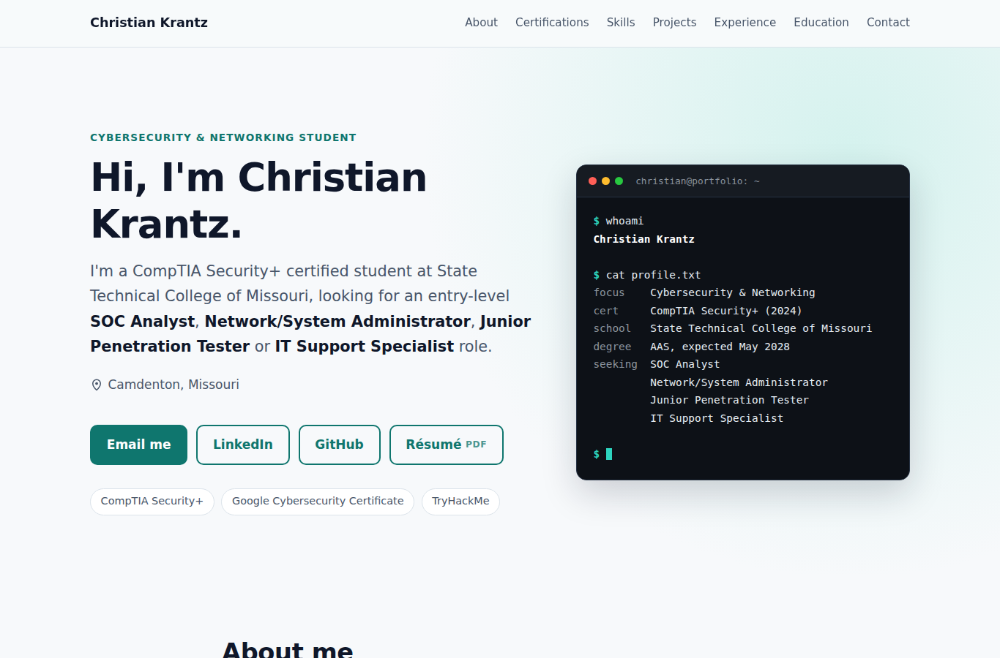

<h1 align="center">Christian Krantz: Portfolio Site</h1>

<p align="center">My portfolio site: certifications, skills and projects, built with HTML, CSS and JavaScript.</p>

<p align="center">
  
  
  
  
</p>

<p align="center"><a href="https://christianjkrantz.github.io/"><strong>Visit the site</strong></a></p>

<p align="center"></p>

## Study apps

| Repository | Study task | Live app |
| --- | --- | --- |
| [Subnet Sprint](https://github.com/ChristianJKrantz/subnet-sprint) | Learn subnetting on a guided path: a short lesson for each skill, practice until it sticks, and spaced review. Then work full worksheets, VLSM problems and your weak spots. | [Open app](https://christianjkrantz.github.io/subnet-sprint/) |
| [No Shutdown](https://github.com/ChristianJKrantz/no-shutdown) | Learn Cisco IOS one unit at a time: a short lesson, drills until it sticks, then a checkpoint task on a simulated router or switch. Packet Tracer labs and a free sandbox too. | [Open app](https://christianjkrantz.github.io/no-shutdown/) |
| [Tier One](https://github.com/ChristianJKrantz/tier-one) | Train for the Windows help desk with lessons, command drills and support tickets. Hints come first, the answer shows after two misses, and missed tickets come back for review. | [Open app](https://christianjkrantz.github.io/tier-one/) |
| [Algebra Workbook](https://github.com/ChristianJKrantz/algebra-workbook) | Work through college algebra: every lesson ends with a problem to try yourself, then generated practice with hints, spaced flashcards and review by topic. | [Open app](https://christianjkrantz.github.io/algebra-workbook/) |

## Web development projects

| Project | Description |
| --- | --- |
| [Weather Dashboard](https://github.com/ChristianJKrantz/weather-dashboard) | City weather search with current conditions and a 5-day forecast |
| [Work Day Scheduler](https://github.com/ChristianJKrantz/Scheduler) | Hour-by-hour daily planner saved in the browser |
| [Coding Quiz](https://github.com/ChristianJKrantz/coding-quiz) | Timed JavaScript quiz with a high-score board |
| [Taskmaster Pro](https://github.com/ChristianJKrantz/taskmaster-pro) | Kanban task board with drag-and-drop, due dates and overdue warnings |
| [Password Generator](https://github.com/ChristianJKrantz/super-secure-password-generator) | Strong passwords from the Web Crypto API, built from criteria you choose |
| [README Generator](https://github.com/ChristianJKrantz/readme-generator) | Node.js command-line tool that writes a README for you |
| [Run Buddy](https://github.com/ChristianJKrantz/run-buddy) | Responsive landing page for a running-coach service |
| [Horiseon](https://github.com/ChristianJKrantz/horiseon-challenge) | Accessibility and SEO refactor of a marketing site |

## Features

- Sections for About, Certifications, Skills, Projects, Experience, Education and Contact, plus a résumé download
- Project cards with screenshots and links to each live demo and its code
- Automatic light and dark mode that follows your system setting
- Responsive layout with a mobile menu
- Accessible: semantic HTML, a skip link, visible keyboard focus and reduced-motion support
- No frameworks or build step

## Project Structure

```
├── index.html
└── assets/
    ├── css/style.css
    ├── js/main.js        # Mobile menu and footer year
    ├── docs/             # Résumé (PDF)
    └── img/
        ├── og-image.png  # Link preview image
        └── projects/     # Project screenshots
```

## Deployment

GitHub Pages publishes any repository named `<username>.github.io` as that user's personal site. Changes pushed to `master` go live automatically.

## Author

**Christian Krantz**: [Portfolio](https://christianjkrantz.github.io/) · [LinkedIn](https://www.linkedin.com/in/christianjkrantz) · [GitHub](https://github.com/ChristianJKrantz)
